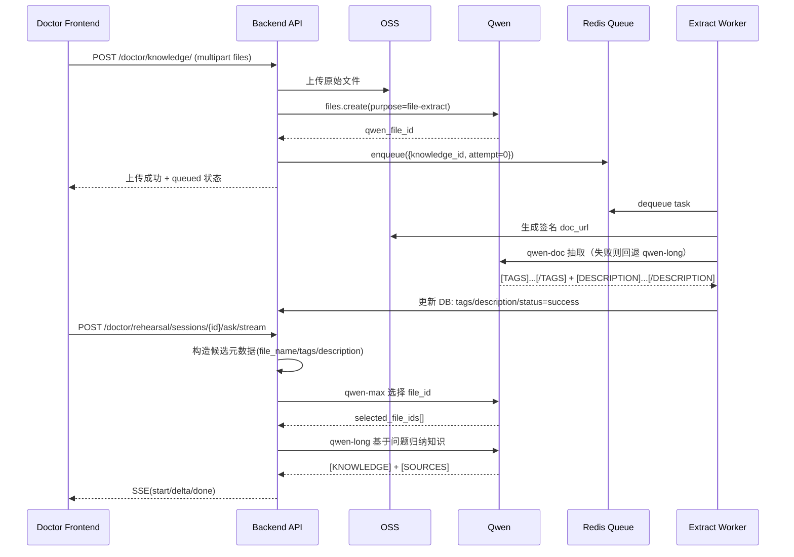

# 医生端 Qwen 知识抽取与问答检索链路（API 交付版）

## 0. 文档目的（给 AI / 团队直接落地）

这份文档用于把医生端“文档入库 + 标签抽取 + 问答检索”能力迁移到其他项目。目标是让 AI 编码助手或工程团队可以直接按接口契约实现，不需要反复理解业务上下文。

核心链路固定为：

1. `qwen-doc` / `qwen-long` 抽取文档标签与摘要描述（异步）
2. 问答时由 `qwen-max` 基于文档元数据选择 `file_id`
3. `qwen-long` 基于问题 + 选中文档做知识抽取（带出处）
4. （可选）再交给 `qwen-max` 做最终面向用户的话术回答

---

## 1. 角色与职责

- `qwen-doc-turbo`：优先做文档抽取（输入 `doc_url`），输出标签和文档描述
- `qwen-long`：兜底抽取（输入 `fileid://...`），以及问答阶段知识归纳
- `qwen-max`：问答前的文件选择器（只基于文件名/标签/描述元数据选 `file_id`）

---

## 2. 总体时序（医生端）



---

## 3. 数据模型（最小必需字段）

### 3.1 知识文件表 `doctor_knowledge`

| 字段 | 类型 | 说明 |
| --- | --- | --- |
| `id` | int | 主键 |
| `doctor_id` | int | 医生归属 |
| `file_name` | string | 原始文件名 |
| `object_key` | string | OSS 对象 key |
| `oss_url` | string | OSS 访问地址 |
| `qwen_file_id` | string | Qwen 文件 ID（问答和抽取核心） |
| `extract_status` | enum | `pending/queued/running/success/failed` |
| `knowledge_status` | enum | `pending/synced/failed` |
| `knowledge_description` | text | 文档摘要描述 |
| `extract_raw_output` | text | 模型原始输出（排错） |
| `extract_error` | text | 抽取失败原因 |
| `extract_retry_count` | int | 重试次数 |
| `extracted_at` | datetime | 抽取完成时间 |

标签用多对多表 `knowledge_tag(name)` 关联，保证去重、可聚合。

### 3.2 问答消息表 `doctor_rehearsal_message`（建议）

| 字段 | 类型 | 说明 |
| --- | --- | --- |
| `selected_file_ids` | json[] | 本轮 qwen-max 选中的 `file_id` |
| `selected_file_meta` | json[] | 对应文件元数据快照 |
| `grounding_answer` | text | qwen-long 知识归纳结果 |
| `grounding_sources` | json[] | qwen-long 来源文件 ID |
| `search_sources` | json[] | 联网来源（如启用搜索） |
| `input_tokens/output_tokens/total_tokens` | int | token 用量 |
| `generation_status` | enum | `generating/succeeded/failed` |

---

## 4. API 契约（对外交付）

以下接口基于当前项目实现，路径前缀统一为 `/api`。

### 4.1 上传医生知识文件

- `POST /doctor/knowledge/`
- `Content-Type: multipart/form-data`
- 入参：
  - 单文件：`file`
  - 多文件：`files`（同名 key 多个）
- 行为：
  - 文件入 OSS
  - 注册 Qwen `file_id`
  - 入 Redis 抽取队列
- 关键返回字段：
  - `extract_queued_count`
  - `extract_failed_count`
  - `items[].qwen_file_id`
  - `items[].extract_status`

### 4.2 查询知识文件列表

- `GET /doctor/knowledge/`
- 用于轮询抽取状态
- 关键字段：
  - `extract_status`
  - `knowledge_status`
  - `knowledge_description`
  - `tags`
  - `extract_error`

### 4.3 知识索引接口（给选择器）

- `GET /doctor/knowledge/indexes/`
- 返回轻量元数据：

```json
[
  {
    "file_name": "xxx.pdf",
    "file_id": "file-xxx",
    "tags": ["标签A", "标签B"],
    "description": "文档描述..."
  }
]
```

### 4.4 手动重触发抽取

- `POST /doctor/knowledge/{knowledge_id}/extract/`
- 将状态重置为 `queued` 并重新入队

### 4.5 流式问答入口

- `POST /doctor/rehearsal/sessions/{session_id}/ask/stream/`
- `Content-Type: application/json`
- 请求体示例：

```json
{
  "question": "血压偏高并伴有头痛，应该怎么处理？",
  "forced_search": true,
  "enable_audio": false
}
```

- 返回：`text/event-stream`
- 事件：
  - `start`：`selected_file_ids`、`selected_file_meta`、`grounding_sources`
  - `delta`：增量文本
  - `done`：`usage` + `search_sources`
  - `error`：流程错误

---

## 5. 模型调用规范（必须按此约束）

### 5.1 文档抽取阶段（异步 Worker）

### 第 1 优先：`qwen-doc-turbo`

- 输入：
  - system prompt：约束只能输出 `[TAGS]` 与 `[DESCRIPTION]`
  - user prompt：带 `{{file_name}}`
  - `doc_url`：OSS 签名地址
- 输出强约束：

```text
[TAGS]标签1|标签2|标签3[/TAGS]
[DESCRIPTION]60-180字中文摘要[/DESCRIPTION]
```

### 回退：`qwen-long`

- 触发条件：
  - `qwen-doc` 调用失败
  - 或输出解析失败（缺少 TAGS / DESCRIPTION）
- 输入：
  - `system`: 抽取系统提示词
  - `system`: `fileid://{file_id}`
  - `user`: 抽取用户提示词

### 失败重试策略

- 默认最大重试 `2` 次（可配置）
- 普通错误：按 `retry_delay_seconds * attempt` 延迟重试
- 若包含 `"File parsing in progress"`：使用更长延迟重试

### 5.2 问答阶段文档选择（`qwen-max`）

输入候选元数据数组（最多建议 20 条，每条包含 `file_id/file_name/tags/description/score`），由模型返回：

```json
{
  "selected_file_ids": ["file-xxx", "file-yyy"],
  "reason": "一句话说明选择依据"
}
```

硬约束：

1. 只允许选择候选集合中已存在的 `file_id`
2. 最多 2 个 `file_id`
3. 寒暄/通用问答返回 `[]`

后端必须做二次校验和去重，不信任模型原样输出。

### 5.3 问答阶段知识抽取（`qwen-long`）

当 `selected_file_ids` 非空时触发，输入：

- `system`: 知识归纳系统提示词
- `system`: `fileid://{id1,id2}`（优先多文件）
- `user`: 当前问题

输出格式要求：

```text
[KNOWLEDGE]
先结论后解释
[/KNOWLEDGE]
[SOURCES]
- fileid://xxx ...
[/SOURCES]
```

回退策略：

- 多文件调用若报 `Invalid file [id:...]`
- 自动降级为“逐文件单独归纳 + 后端合并”

---

## 6. 关键提示词模板（可直接复用）

### 6.1 文档抽取 Prompt（简版）

- system：只允许两行输出 `[TAGS]...[/TAGS]` + `[DESCRIPTION]...[/DESCRIPTION]`
- user：包含 `{{file_name}}`，要求标签覆盖疾病/症状/检查/治疗/药物/风险/人群/场景

### 6.2 文件选择 Prompt（简版）

- system：医学检索排序助手，只输出 JSON
- user：注入 `{{question}}` + `{{candidates_json}}`，要求最多 2 个 `file_id`

### 6.3 知识归纳 Prompt（简版）

- system：严格基于 fileid 文档回答，必须标注来源
- user：要求输出 `[KNOWLEDGE]` 与 `[SOURCES]`

---

## 7. 环境变量清单（迁移项目至少需要）

- `DASHSCOPE_API_KEY`
- `DASHSCOPE_BASE_URL`（默认兼容模式）
- `QWEN_DOC_MODEL`（默认 `qwen-doc-turbo`）
- `QWEN_LONG_MODEL`（默认 `qwen-long`）
- `QWEN_REHEARSAL_SELECTOR_MODEL`（建议 `qwen-max` 系列）
- `QWEN_REHEARSAL_LONG_MODEL`（默认 `qwen-long`）
- `QWEN_REHEARSAL_ANSWER_MODEL`（默认 `qwen-max-latest`）
- `REDIS_URL`
- `KNOWLEDGE_EXTRACT_QUEUE_KEY`
- `KNOWLEDGE_EXTRACT_MAX_RETRIES`

---

## 8. 迁移到其他项目的最小落地清单

1. 建立知识文件表 + 标签表 + 问答消息表（含 `selected_file_ids` 和 `grounding_answer`）
2. 实现文件上传接口（OSS + Qwen `file_id` 注册 + 入队）
3. 实现抽取 Worker（`qwen-doc` 优先，`qwen-long` 回退，状态机完整）
4. 提供知识索引接口（给 `qwen-max` 选择器喂元数据）
5. 实现问答流式接口（先选择 `file_id`，再 `qwen-long` 归纳）
6. 对所有模型输出做服务端校验（JSON、file_id 合法性、最大数量）

完成以上 6 步，即可在新项目复刻当前医生端“知识驱动问答”能力。

---

## 9. 状态机与错误处理（建议原样复用）

### 9.1 抽取状态机

- 初始：`pending`
- 入队成功：`queued`
- Worker 消费：`running`
- 抽取成功：`success`（同时 `knowledge_status=synced`）
- 抽取失败：`failed`（同时 `knowledge_status=failed`）

### 9.2 问答阶段回退策略

1. `qwen-max` 选中文档为空：跳过 `qwen-long`，直接走最终回答模型
2. `qwen-long` 多文件报 `Invalid file`：回退单文件逐个归纳后拼接
3. SSE 期间音频失败：仅推送 `audio_error`（若启用语音），文本主流程不中断

---

## 10. 当前项目实现映射（便于快速对照）

- 上传与入队：`mdapi/views.py` -> `DoctorKnowledgeView.post`
- 手动重抽：`mdapi/views.py` -> `DoctorKnowledgeExtractView.post`
- 队列封装：`mdapi/services/knowledge_queue.py`
- 抽取服务：`mdapi/services/qwen.py`
- 抽取 Worker：`mdapi/management/commands/run_knowledge_worker.py`
- 问答编排：`mdapi/services/rehearsal.py`
- 流式问答入口：`mdapi/views.py` -> `DoctorRehearsalAskStreamView.post`
- 提示词目录：`prompts/qwen/`

